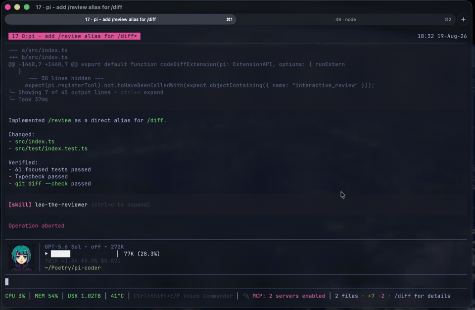
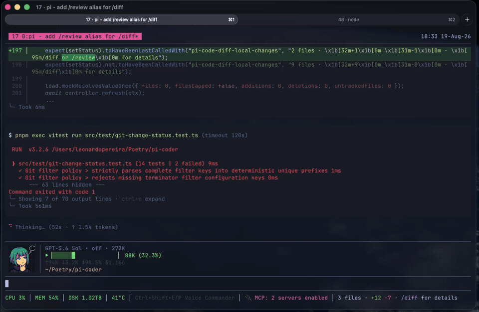

# pi-coder

`pi-coder` adds full-screen coding tools to [Pi](https://github.com/badlogic/pi-mono), and runs the same tools without Pi:

- `/diff` and its `/review` alias review local changes, commits, branches, ranges, and configured remote pull requests.
- `/code` browses and edits a workspace without leaving Pi.
- `/diff-story` arranges a change as ordered code steps with linked implementation and test diffs.
- Experimental in 0.9.9: the `pi-coder` command opens all three in any terminal, and hands the result to any agent: Claude Code, Codex, another agent tool, or a plain shell. See [Use it outside Pi](#use-it-outside-pi).

> **0.9.9 status.** Everything Pi loads — the three commands above, the footer summary, and the skills — is supported. The standalone command, the agent-tool surface, and the MCP server ship for testing only; they are not supported behavior yet and will be reworked before 1.0.

Inside Pi, it also keeps a compact repository summary in Pi's footer so you can see the current file count, additions, and deletions between reviews. New, untracked files count individually and contribute their text additions. If Git cannot return complete counts, incomplete line totals are omitted rather than shown as exact.

For a deeper walkthrough of the workflow, usage, and the engineering reasoning behind it, read [The Human in the Loop](https://blog.leonardopereira.com/2026/08/19/the-human-in-the-loop/).

## Try without installing

```bash
pi -e npm:pi-coder
```

This runs the published package for the current Pi invocation without adding it to your project configuration.

## Install

```bash
pi install npm:pi-coder
```

To install the latest source directly from GitHub instead:

```bash
pi install https://github.com/dantetekanem/pi-coder
```

Restart Pi or run `/reload`.

To use pi-coder without Pi, install the command:

```bash
npm install -g pi-coder
```

### Pi compatibility and security baseline

Use Node.js 22.19.0 or newer. Inside Pi, use `@earendil-works/pi-coding-agent` and `@earendil-works/pi-ai` at 0.79.10 or newer; they are optional peers that the `pi-coder` command does not load. `@earendil-works/pi-tui` is a regular dependency. Keep the Pi packages on matching releases. The lockfile tests the 0.79.10 minimum; the peer ranges allow newer hosts without requiring Pi 1.x. Newer releases are not all covered by this compatibility check.

This baseline includes the Pi fixes described in these advisories:

- https://github.com/advisories/GHSA-jfgx-wxx8-mp94
- https://github.com/advisories/GHSA-r95r-rj6r-c39x
- https://github.com/advisories/GHSA-7v5m-pr3q-6453
- https://github.com/advisories/GHSA-mqxh-6gq7-558m

The baseline is not an audit-clean guarantee. The 2026-11-01 audit still reports upstream advisories for Pi's pinned `undici` 8.5.0, `minimatch` 10.2.5, and `glob` 13.0.6. The lockfile refreshes compatible `protobufjs`, `zod`, and `brace-expansion` resolutions without overriding Pi's dependency pins. Run `pnpm audit --json` for current findings. Updating this repository's lockfile does not update your installed Pi host or its dependencies; keep that installation current separately. Pi extensions run with the host's permissions, so use trusted repositories or external isolation for untrusted code.

## Review changes

Run `/diff` or `/review` inside a repository:

```text
/diff
/review
```

`/review` is an alias for `/diff`; both commands accept the same targets.



Useful targets:

```text
/diff                         # uncommitted changes
/diff main...HEAD             # a Git range
/diff remote <branch-or-url>  # a remote branch or configured pull request
/diff --resume                # a parked review
/diff fullscreen on|off       # toggle Herdr pane zoom for future reviews
```

In Herdr, `/diff` zooms the current pane while the review is open and restores the previous layout afterward. Fullscreen is on by default; `/diff fullscreen off` disables it persistently until `/diff fullscreen on` enables it again. Launchers can set `PI_CODER_HERDR_FULLSCREEN=on|off` to override the initial behavior for one Pi process without changing the saved preference.

The review UI supports line, file, and review-wide feedback. Feedback can be marked as:

- `DISCUSS` — save a question for the main agent. Press `d` on code to add a note at the selected range.
- `COMMENT` — keep review feedback for a local or remote review.
- `MODIFY` — propose or apply an exact code change.

GitHub pull requests work by default through the authenticated [`gh`](https://cli.github.com/) CLI. Confirmed reviews receive a grammar-safety pass before submission, and saved drafts are revalidated when the reviewed revision changes.

### Follow a diff story

```text
/diff-story                        # walk through the selected local diff
/diff-story main...HEAD            # walk through a range
/diff-story remote <branch-or-url>
/diff-story --resume               # resume a saved review/story
/diff-story agent                  # choose the story model and thinking level
```

The story agent starts as `anthropic/claude-opus-5-5` with `low` thinking. Its selection is saved independently of the main conversation. Model selection validates support for the chosen thinking level.

A full-screen preparation view shows the captured files, change counts, and generation phase. The capture skips non-English/non-pt-BR locale files, as the `/diff` file list does, and shows how many it hid. Press `F` and then `L` to see them in the full diff. The extension extracts changed functions and individual tests locally. Changed lines outside a function join the nearest function in their file; a file without functions becomes one unit. The extension then pairs obvious filename and symbol matches. One model request arranges these prepared units and adjusts their test links. While the step sidebar is on, the same request also writes a summary and a short title and note for each step. The extension supplies the exact ranges and complete changed-line coverage. Without notes, it titles each step with its file and symbol. A step is one change with all of its tests: each paired test appears once, with its implementation. Only test cases (`test "…"`, `it "…"`, `specify`, and `def test_…`) pair with code. Other methods in a test file are helpers: a helper joins the step of the first test that calls it. Setup and other unpaired tests join the step that owns the nearest paired test in their file, and a test file without pairs gets one step. To pair a test, the extension also reads the helpers it calls and ignores quoted strings and `key:` labels, and a changed file named like the test file wins over name matches in other files. When one test file has more than 30 anchored lines in a step, the extension splits its tests across several steps that repeat the same code (the titles end with `tests 1/2`, `tests 2/2`). A comment on repeated code stays one comment, and each step keeps its own seen mark and scroll position. Stories saved by an earlier version keep their steps.

During preparation, a centered five-line strip shows public output, errors, and progress as they arrive, including the final ordering JSON. Gray text uses the normal terminal background, with the newest line at the bottom and older lines fading upward through 100% / 80% / 60% / 40% / 20%, approximated with terminal colors. The strip spans up to 120 columns. `Space` pauses/resumes the strip while generation and the running spinner continue. Elapsed time remains visible. The strip disappears when preparation ends. On generation failure, `r` explicitly retries against the same captured files.

A one-line header shows the step title and its position, such as `2/7`, with `seen` after a marked step. Two unified diffs follow: **Related changed tests** on the left and **Implementation** on the right. The story opens on the code pane, also when you resume, and every step change returns to it. Both panes follow the current step, with faint green/red backgrounds on changed lines and colored addition/deletion counts for the current hunk. You select comment ranges with `Shift+Up/Down`. Each pane shows one file's lines for the current step, plus a few unchanged lines of context. Code owned by another step stays collapsed, so every changed line appears on exactly one page, except code that repeats because its tests were split. Every captured change is reachable through step navigation; omitted units follow the model's ordered steps. At narrow widths the panes stack, with the tests on top; below 40 columns or 27 rows, resize or switch to the full diff.

When a step has no related changed test, the left pane shows the **Existing tests** of its code. pi-coder searches the reviewed revision with `git grep`, inside the code's package: the nearest folder above the code with a package manifest, such as `package.json` or `Gemfile`. A test counts when it names the changed function, or changed code that calls it, and its file mirrors, sits beside, imports, or names that code. pi-coder follows calls only through the files that the change touches. Each file says why its tests match, such as `3 tests mention total, which reaches tax`, and marks the tests that this review changes. Up/Down and PgUp/PgDn scroll the pane when it has focus, and `Option` scrolls it from the code pane. When no test reaches the code, the pane says **No tests found for this code** and names what it searched. That marks untested code, unless a test reaches it through files that the change does not touch. When the search fails or takes more than 20 seconds, the pane says so: that is a gap in pi-coder, not a finding about the code. Steps that change only tests, remove code, or change files that do not run say so instead. The search reads Ruby, Python, and JavaScript/TypeScript tests; for other languages, the pane says that pi-coder cannot read their tests yet.

The **Steps** sidebar on the left shows how the change is built. It starts with the story summary and lists each step by number and title. The current step is highlighted, with the agent's note under it and an arrow down to the steps that follow. It moves with `Shift+Left/Right`. Seen steps show `✓`, and steps that do not fit fold into ranges such as `26–40 · 15 more`. The sidebar is on by default. Press `1` to hide it: pi-coder saves the choice, and new stories then skip the step notes and build faster. Press `1` again to show it. Below 100 columns the sidebar hides and gives its room to the panes.

| Key | Story action |
| --- | --- |
| `Shift+Left` / `Shift+Right` | Previous / next step |
| `Left` / `Right` | Focus tests / implementation |
| `Tab` / `Shift+Tab` | Cycle tests, implementation and comments, forward / backward |
| `h` | Show or hide comments |
| `[` / `]` | Previous / next file in the focused pane |
| `Home` / `End`, `gg` / `G` | Jump the focused pane to its first / last line |
| `Option+Up` / `Option+Down` | Scroll the other pane one row; focus stays where it is |
| `Option+PgUp` / `Option+PgDn` | Scroll the other pane one page |
| `Option+Shift+Up` / `Option+Shift+Down`, `Option+Home` / `Option+End` | Move the other pane to its top / bottom |
| `R` | Mark the current step seen |
| `c` / `d` | Comment / discuss at the selected range |
| `i` | Open the story info: the step, review, totals, captured files, and every step |
| `1` | Show or hide the step sidebar; while it is hidden, new stories skip the step notes |
| `4` | Open PR context; `D` toggles the full description and `Esc` returns to the same step |
| `F` | Inspect the full captured diff, or return to the story |
| `s` | Finish through the normal review flow |
| `Ctrl+?` / `?` / `Ctrl+/` | Open the shortcuts list for the story |

In a review or the full diff, movement follows changed lines by default. Hold `Option` (`Alt`) with movement keys to reach unchanged code; `Option+Shift+↑/↓` selects a context range for a note. In a story, movement stays inside the current page and `Option` scrolls the other pane instead of moving the cursor. Press `C` to let Up/Down and Shift+Up/Down visit the page's unchanged context lines. Cursor keys stay with an active editor. `F` opens the full diff with the same saved comments.

Resume retains the active step, per-pane selections/scroll, marks, and comments, and reopens on the code pane. Changed bytes invalidate the saved story: explicitly rebuild it, use the ordinary diff, or cancel. Existing feedback remains subject to its usual anchor validation.

The model receives unit identifiers, filenames, symbols, reference matches, and proposed test pairs. While the step sidebar is on, it also receives each unit's changed lines, up to 60 per unit and fewer on large changes, so it can write the notes. Full captured code stays available through `F`. Requests use the provider's token, timeout, and retry settings. Cancel preparation with `Esc` or `Ctrl+C`. Before opening a story, the extension validates its anchors against the captured revision and reports unreadable files, binary content, or invalid output.

### Discuss saved review notes

In `/diff` and `/diff-story`, `d` opens the normal comment editor with DISCUSS intent. Save the note with `Enter` and continue reviewing. Finish with `s` to hand feedback to the main agent; remote reviews offer “Start discussion with agents” when DISCUSS notes exist. COMMENT and MODIFY items stay saved for the PR author. After the discussion, confirm “Good to continue the review?” to reopen the saved review.

### Review submission and recovery

`s` submits at any time. A stale line comment still posts on its lines when the diff shows them and they hold the code it was written on. Otherwise it posts as a file comment that names its original lines and quotes that code when known. Comments on files that left the review stay in the saved draft.

GitHub reviews pin the reviewed commit for every verdict, including approvals without comments. An approval with inline feedback uses one atomic review. Submission reports `submitted`, `partial`, `unknown`, or `rejected`; a timeout is not proof that nothing was posted.

Approved input is saved under an attempt ID before any write. Pass `attemptId` to reuse that decision. The UI resumes unfinished submissions or exact accepted feedback still awaiting cleanup. After a submission completes, remaining unsubmitted feedback can be reviewed or discussed. Confirmed steps are not reposted; uncertain steps require attributable provider evidence. Use `newIntent` only for an explicitly approved new review. A failed grammar pass keeps a separate, unconfirmed handoff until the final text is approved.

UI and tool submissions share draft cleanup. Only confirmed items whose saved IDs and full fingerprints still match are consumed; edited and unsubmitted feedback remains. Local receipt, journal and draft failures are reported separately from remote acceptance. See [submission evidence and recovery limits](docs/remote-providers.md#submission-evidence).

### Drafts and interrupted typing

A normal `/diff` opens a fresh review instance, even for a target with saved feedback. Use `/diff --resume` to pick an existing instance, or add `--resume <id>` after a local, range, or remote target. Picker labels include the instance ID; legacy drafts remain explicitly resumable. Discarded and retired draft-only IDs cannot be reused. Reviews with story or historical discussion data remain resumable after accepted feedback is consumed.

Snapshot saves compare the last loaded generation under a process-safe local store lock. A stale writer does not overwrite another review's feedback. On a conflict or storage error, keep the review open and copy or resolve its text; the UI does not reload a newer generation and replay stale edits. Picker membership is rebuilt from valid snapshots, including after an interrupted index update. Snapshots expire after 30 days without a snapshot update; terminal tombstones are retained indefinitely.

While a comment editor is active, its target, intent, original selection/anchor, text and cursor are saved separately from committed feedback. A first-change timer flushes at a **two-second deadline**, including during continuous typing. The intended typing loss window is at most two seconds with functioning, uncontended storage and a responsive event loop, within the limits below. Full review snapshots are not written per keystroke. Opening the first editor establishes a discoverable review snapshot before its first recovery write.

- `Enter` flushes the buffer and commits feedback before closing the editor. Failed writes keep it open and leave recovery copies intact.
- `Ctrl+C` inside the editor flushes and parks without committing the buffer. `Esc` cancels a new editor; for a recovered editor it leaves the text saved for later recovery.
- Explicit resume offers unfinished editor copies. Recovery opens editable text at its saved cursor; it never submits feedback. Each opening gets a separate composition ID, so two processes resuming one instance do not overwrite each other's buffers.
- Recovery checks the original file, scope and exact source anchor. Changed or unavailable bytes produce a stale draft; reanchor it manually to keep it on lines. A renamed/missing file or repository frame leaves the text editable but blocks saving it onto another target: copy it and manually choose the intended anchor.
- If recovered text conflicts with the current note or selected comment, `Enter` asks **"Replace with recovered text; keep current text as recovery?"** Only `k` confirms. The exact current text and its intent/target are saved as a separate recovery before the generation-checked replacement. Any preservation or snapshot failure keeps the editor open. `Esc` returns to editing. If a recovered range would also remove other comments, saving is refused instead: the current comments and recovered buffer stay intact for manual merging.

Recovered buffers use the owned exact-text editor: arrows move the cursor, `Ctrl+A` selects all and `Ctrl+Z` undoes; `Tab` changes intent and `Shift+Enter` inserts a newline. New COMMENT/DISCUSS editors retain Pi's editor controls. Their completed bracketed pastes now remain expanded rather than collapsing into Pi paste markers, so cursor positions refer to the saved text. Chunked pastes are inserted when the closing paste marker arrives; an incomplete paste is not yet part of the editor buffer.

Recovery records live under `~/.pi/agent/cache/pi-coder/sessions/compositions` (or `PI_CODER_SESSIONS_DIR/compositions`). Each JSON record is limited to 256 KiB, including text and anchor metadata. The shared store allows 64 recovery records and 16 MiB, including replacement byte capacity. Valid copies older than seven days since their last write are removed during recovery-store operations. Unknown or interrupted-write files remain for manual inspection and count against capacity. Limits and write failures report errors; they never truncate text or evict fresh copies to make space. Terminal instances do not offer their old compositions for recovery.

The `.write-lock` mutex never waits or removes an owner based on age or PID status. After a crash, **stop all writers** before manually inspecting and removing `.write-lock/owner.json` and its empty `.write-lock` directory. Do not remove a live lock or run mixed older writers against this store. The contract covers process interruption on a local filesystem; it does **not** include network/shared filesystems, `fsync`, or power-loss durability.

### Remote providers

GitHub pull requests work through the authenticated [`gh`](https://cli.github.com/) CLI without extra configuration. See [Remote providers](docs/remote-providers.md) to add another code host or configure repository-specific paths.

The footer is one line, `Shortcuts: c (Comment) - d (Discuss with Agent) - Ctrl+? (All Shortcuts)`. A story adds `- i (Info)`. Common review controls:

| Key | Action |
| --- | --- |
| `Ctrl+?` / `?` / `Ctrl+/` | Open or close the shortcuts list over the review or story. Up/Down, PgUp/PgDn and Home/End scroll it and `Esc` closes it. Legacy terminals, and tmux without `extended-keys`, send Ctrl+? as the Backspace byte, so pi-coder never reads Backspace as this key; `?` and `Ctrl+/` work everywhere. |
| Arrow keys | Navigate files and changed diff lines by default |
| `Home` / `End`, `gg` / `G` | Jump the focused pane to its first / last item |
| `Option`/`Alt` + `↑` / `↓` / `PgUp` / `PgDn` / `Home` / `End` | Reach any code line, revealing collapsed context as needed; add `Shift` to select a range |
| `c` / `d` | Add a comment / discussion |
| Mouse drag | Select text and copy it when you release. In a diff, the copy holds only code, without line numbers, `+`/`-` signs, or the other side. Double-click selects a word and triple-click a line. |
| `gf` | Open the selected line on the code host at the reviewed commit. Needs a pull request review and the provider's `urls.file` setting. |
| `gd` or Ctrl+click | Search for where the double-clicked or Ctrl+clicked symbol is defined. Needs the `search` setting. |
| `Enter` or `m` | Edit the selected line |
| `v` | Toggle unified and side-by-side views; from an opened PR thread, jump to its verified code location |
| `I` | Show or hide open PR threads under the lines they belong to. The lines keep a `○` marker either way. |
| `s` | Finish the review |
| `Esc` | Go back or close safely |
| Replies: `t` / `Enter` / `o` / `A` | Switch personal/all fetched threads; inspect full text; open browser; analyze read-only. PgUp/PgDn and gg/G scroll; Esc returns. |
| Opened thread: `e` | Edit a response buffer for this review window only |

### Current PR context

Remote `/diff` and `/diff-story` show the PR title, reviewed revision, and a short author-derived brief. The same orientation stays visible during story preparation. In the context pane, `D` switches between the brief and the author's complete description, preserving each view's scroll position.

The context pane starts with the brief and fetched PR facts. When an optional generated explanation arrives, it appears above those facts under its own label. The original description remains available through `D`.

Known checks, comments, and reviews appear while slower conversation reads are still pending. Failed or limited sections are labeled unavailable; successfully fetched facts remain visible.

PR context and Replies distinguish missing resolution from an unresolved thread. Replies from deleted or unavailable authors remain visible as `unknown`.

A remote review reads the PR's review threads in the background when it opens, even when PR context and Replies are hidden. A `○` marks each line with an open thread (unresolved, or with unknown resolution) when the thread's anchor matches the reviewed code, and the Navigator shows each file's count, such as `2○`. Press `I` to show or hide the thread text under its line; pi-coder remembers the choice. These threads are read-only. They never join your draft, the Comments pane, the submission, or the agent prompt, and your own feedback marker keeps a shared line. The diff header counts threads it could not place as `N more in Replies`, where `t` lists every fetched thread.

Both panes label incomplete thread reads. An empty partial result means no replies were found in the fetched threads, not that the whole PR conversation is empty.

PR context and Replies share pending reads within a review window. Supplied context stays read-free until refresh; it has no authenticated viewer or stable thread IDs. In either pane, press `r` for a fresh generation, even at the same head, or `m` to resume a ready continuation. The header shows the latest read's generation, time, coverage, and known open/unknown-resolution counts. Failed refreshes retain usable panes with their original metadata. Reply selection and context scroll are preserved. Replies shows fetched totals separately from the 100-reply and 1,200-character preview limits.

From an opened thread, `e` restores its response buffer or starts from that thread's analyzed suggestion. `Enter`, `Esc`, or `Ctrl+C` keeps the buffer; `Shift+Enter` inserts a newline. Buffers survive thread changes and refreshes within this window. They never become review feedback, go to the provider, or survive closing the window, including when parking a review.

## Browse and edit code

Run the Explorer, or open a repository-relative file directly in INSERT mode:

```text
/code
/code app/models/user.rb
```

The Workbench remains the default. To use one command for every code-opening interface instead, add it to `~/.pi/agent/pi-coder-settings.json`. This example runs TTT through tmux:

```json
{
  "code": {
    "command": ["tmux", "split-window", "-h", "-c", "{cwd}", "ttt", "{cwd}"],
    "targetArgs": ["{file}:{line}"]
  },
  "providers": {},
  "repositories": {}
}
```

`command` is direct argv, not a shell string, and supports only `{cwd}`. Optional `targetArgs` are appended for file targets and support `{cwd}`, `{file}`, and `{line}`. Pi waits for the command to finish. In this example, tmux returns after creating the pane, so Pi is ready while TTT stays open.

The same command handles `/code`, `open_code`, `open_code_diff`, and the review UI's open-code action. Without a configured command, the existing Workbench and review UI behavior remains unchanged.



`/code` fills the small gap between the coding agent and you. It is for the last 1% of the work, when you want to open the file yourself, read the code around it, make a small change, or point to exact lines and ask a question. Instead of leaving Pi or asking the agent to paste fragments into the conversation, you can work with the code directly and continue where you left off.

`/code` is not a replacement for Vim, Neovim, VS Code, or the editor you already use. If one of those is already part of your workflow, keep using it. But learning Vim or Neovim just to inspect one function makes no sense, and opening something as heavy as VS Code can be more than the moment needs. `/code` is the minimum viable coding tool: a small project explorer, readable source, search, and enough editing for focused changes. The agent can take you to the exact file and lines, guide you through related parts of the code, and bring a selected piece back into the conversation when you want to discuss it. It protects unsaved work, will not overwrite a file changed somewhere else, and stays away from staging, commits, and pushes. The goal is not less human involvement. It is keeping the human loop powerful without slowing the work down.

Run `/code syntax` to choose and remember any syntax theme bundled with Shiki. The selection applies the next time `/code` opens.

Common Workbench controls:

| Key | Action |
| --- | --- |
| Arrow keys or `j` / `k` | Navigate files and source lines |
| `Enter` | Open a file or enter INSERT mode |
| `Tab` / `Shift+Tab` | Move between Explorer and Source |
| `/` | Find a file or search the current buffer |
| `n` / `N` | Move through buffer matches |
| `Ctrl+S` | Save |
| `Esc` | Leave INSERT, return to Explorer, or close safely |

See [docs/workbench.md](docs/workbench.md) for the full Workbench behavior and standalone runner.

## Agent tools

Agents can use the same interfaces through:

- `open_code` — run the configured code command at an optional path or structured target; without one, open the Workbench.
- `open_code_diff` — run the configured code command; without one, open `/diff` with an optional target and prepopulated comments.
- `open_code_diff_story` — open `/diff-story` with the same targets and `cwd`. It always uses the built-in story view, even with a configured code command.
- `submit_pr_review` — submit a confirmed configured-provider review.

## Use it outside Pi

> **Experimental in 0.9.9.** These surfaces ship for testing and may change before 1.0. The Pi extension does not depend on them.

The `pi-coder` command runs the same review, diff story, and workbench in a terminal:

```bash
pi-coder diff main...HEAD
pi-coder story remote https://github.com/owner/repository/pull/123
pi-coder code src/app.ts
```

When you finish, it prints the text Pi would give its agent: your review feedback or DISCUSS notes. Add `--json` for one result object. It reads the same settings, drafts, and submissions as the extension.

Agents in other harnesses call the same tools:

- `pi-coder tool open_code_diff --input '<json>'` runs a tool with the Pi tool input and result. From an agent's shell, the screen opens in a new Herdr or tmux pane and the command waits for the user.
- `pi-coder mcp` serves the tools over MCP for Claude Code, Codex, and other MCP clients.
- `skills/pi-coder/SKILL.md` tells an agent how to open a review, read the feedback, continue a discussion, and submit a review.

Outside Pi, the grammar pass and the story agent use model commands from `pi-coder-settings.json`, or `pi -p` when Pi is installed. Read [The pi-coder command](docs/cli.md) and [Use pi-coder from other agents](docs/harnesses.md).

## Security and data access

Read [SECURITY.md](SECURITY.md) for private vulnerability reporting and [docs/access.md](docs/access.md) for the exact subprocess, filesystem, and network access used by the package.

## Development

```bash
pnpm install
pnpm typecheck
pnpm test
```

Run the command from a checkout with `node bin/pi-coder.mjs --help`. Build the standalone Workbench with `pnpm workbench:build`.

## Acknowledgments

Inspired by Mario Zechner's [pi-diff-review](https://github.com/badlogic/pi-diff-review), with thanks to [Rob Zolkos](https://github.com/robzolkos) for his contributing work on the review workflow.

## License

MIT
